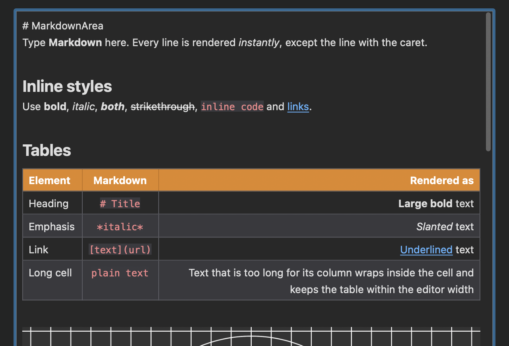
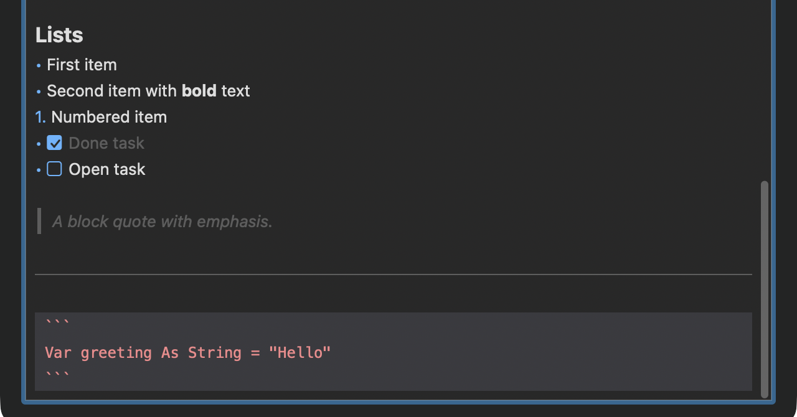

# MarkdownArea

A live-rendering Markdown editor control for Xojo desktop apps, written in pure Xojo code. It needs no plugins, HTMLViewer or WebView.



## What it's for

`MarkdownArea` is a drop-in replacement for a `DesktopTextArea` when your users write Markdown: notes, documentation, comments, README files, issue text and so on.

It works like editors such as Typora or Obsidian's live preview. The text stays plain Markdown, but every line is shown rendered **as you type**. Only the line with the caret shows its raw Markdown, so you can always see and edit the syntax you're working on. Move the caret away and the line renders again.

The `Markdown` property always holds the raw, unchanged Markdown, so you can save and load it like any other string. The editor can also show the whole document as plain text: see [Rendered and plain text view](#rendered-and-plain-text-view).



## Features

### Markdown rendering

- **Headings**: `#` to `######`, each scaled to its own size
- **Inline styles**: `**bold**`, `*italic*`, `***bold italic***`, `__bold__`, `_italic_`, `~~strikethrough~~` and `` `inline code` ``
- **Links**: `[text](url)` drawn as underlined links. Cmd+click (macOS) or Ctrl+click (Windows/Linux) opens them. Web, `mailto:` and `tel:` links, as well as local file paths, are supported.
- **Images**: `` displayed inline, scaled to the editor width. Sources can be
  - `http://` / `https://` URLs, downloaded asynchronously
  - `data:` URIs
  - local files, absolute or relative to `BaseFolder`
  - anything your app supplies itself through the `ImageRequested` event, e.g. from a database or the app's resources
- **Tables**: GitHub-style pipe tables with a header row, `:---` / `:---:` / `---:` column alignment, striped rows and text that wraps inside its cell so the table always fits the editor width
- **Lists**: bulleted (`-`, `*`, `+`) and numbered lists
- **Task lists**: `- [ ]` / `- [x]` drawn as checkboxes, with completed tasks dimmed
- **Block quotes**: `>`
- **Horizontal rules**: `---`
- **Fenced code blocks**: shown in a monospaced font on a shaded background

### Editing

- Full caret and selection handling with the keyboard and the mouse, including word-wise movement, Home/End, Page Up/Down, double-click to select a word and triple-click to select a line
- Undo/Redo with up to 200 steps, typing grouped into sensible steps
- Cut, Copy, Paste and Select All through the standard Edit menu, keyboard shortcuts and a built-in context menu
- Shortcuts: **Cmd/Ctrl+B** bold, **Cmd/Ctrl+I** italic, **Cmd/Ctrl+K** link
- A **floating formatting toolbar** that appears when the mouse comes near the top edge. It has a rendered/plain text toggle, bold, italic, strikethrough, inline code, H1–H3, bulleted/numbered/task lists, quote, link, image, code block, table and horizontal rule. Buttons that don't fit a narrow editor are left out automatically, starting from the right.
- A **rendered/plain text toggle**, in the toolbar and from code. See [Rendered and plain text view](#rendered-and-plain-text-view).
- An optional **read-only mode**. See [Read-only mode](#read-only-mode).

### Look & platform

- Light and **dark mode** support with matching colors for code, tables, quotes, links and selection
- HiDPI / Retina ready
- Built-in mouse-wheel scrolling and a slim scroll bar
- Toolbar and context menu strings are dynamic constants, ready for localization
- Native double-click timing on macOS and Windows

## Requirements

- Xojo 2021r3 or newer (the project is saved with Xojo 2026r3)
- Desktop projects on macOS, Windows or Linux

## Installation

1. Copy `MarkdownArea.xojo_code` into your project (drag it into the Xojo navigator).
2. Drag a `DesktopCanvas` onto a window and set its **Super** to `MarkdownArea`.
3. Set the `Markdown` property, or let your users start typing.

To use `MarkdownArea` in place of a `DesktopTextArea` you already have, see [Replacing a DesktopTextArea](#replacing-a-desktoptextarea).

The included demo project (`MarkdownArea.xojo_project`) shows a window with sample content for every supported element.

## Usage

```xojo
// Load Markdown and show it rendered
MarkdownArea1.Markdown = "# Hello" + EndOfLine + "This is **Markdown**."

// Save Markdown
Var markdown As String = MarkdownArea1.Markdown

// Load plain text and show it unrendered
MarkdownArea1.Text = notes

// Resolve relative image paths against the document's folder
MarkdownArea1.BaseFolder = documentFile.Parent

// Append text at the end of the document
MarkdownArea1.AddText(EndOfLine + "- [ ] New task")
```

### Rendered and plain text view

The editor shows the document either rendered as Markdown or as plain text, with every Markdown character visible. The text itself never changes, only how it's shown.

Users switch the view with the first toolbar button. Its icon shows the current view: an "M" and an eye for rendered Markdown, a "T" and an eye for plain text. Its tooltip says which view a click switches to.

In code, the property you load the text through picks the view:

| You set | The view switches to | Use it for |
|:--|:--|:--|
| `Markdown = value` | Rendered Markdown | Markdown documents |
| `Text = value` | Plain text, like a `DesktopTextArea` | Plain text, or code that was written for a `DesktopTextArea` |
| `RenderMarkdown = True` / `False` | Rendered / plain text | Switching the view without loading new text |

```xojo
// A Markdown document opens rendered
MarkdownArea1.Markdown = readmeContents

// A plain-text note opens unrendered
MarkdownArea1.Text = noteContents

// Switch the view later; the text stays the same
MarkdownArea1.RenderMarkdown = False
```

Reading `Markdown` or `Text` returns the same raw text, whichever view is shown.

Setting `Markdown` or `Text` to an empty string clears the editor but keeps the current view. Xojo applies the Inspector's empty `Text` to every control when its window opens, so without this rule every MarkdownArea would open in plain text.

`Markdown` is only available in code, not in the Inspector. Text you type into the Inspector's `Text` field goes through `Text`, so it opens as plain text. To show design-time text rendered, set `Markdown` in the control's `Opening` event instead.

### Read-only mode

Set `ReadOnly` to `True` to show a document that users can't change. They can still select and copy text, and Cmd/Ctrl-click links.

A read-only editor has no formatting toolbar, because none of its buttons could be used. Instead, a small view button appears in the top right corner while the mouse is over the editor, so users can still switch the view. It doesn't wait for the mouse to come near the top edge, and it disappears when the mouse leaves the editor. A thin outline and a soft shadow keep it visible over the text. Its icon shows the view you're reading: **M** and an eye for rendered Markdown, **T** and an eye for plain text. To hide this button, set `ReadOnlyRenderToggle` to `False`. Setting `HasToolbar` to `False` hides it too.

When `ReadOnly` is set back to `False`, the full toolbar returns and appears again when the mouse comes near the top edge.

### Replacing a DesktopTextArea

`MarkdownArea` has the properties, methods and events of `DesktopTextArea` (except the macOS-only `StyledTextPrinter`), so existing code and window layouts keep compiling:

1. Add `MarkdownArea.xojo_code` to your project.
2. Select the `DesktopTextArea` in the window editor and change its **Super** to `MarkdownArea`. The values you set in the Inspector carry over.
3. Run the project.

Existing code that sets `Text` keeps working, and the editor shows that text as plain text, just as the TextArea did. To show it rendered instead, switch the assignment to `Markdown`, or set `RenderMarkdown = True` afterwards.

Some `DesktopTextArea` members behave differently or have no effect, because Markdown keeps its formatting in the text itself. [DesktopTextArea compatibility](#desktoptextarea-compatibility) lists them all.

### Handling links yourself

```xojo
Function LinkClicked(url As String) As Boolean
  If url.BeginsWith("app://") Then
    HandleInternalLink(url)
    Return True // MarkdownArea won't open the link itself
  End If
  Return False
End Function
```

### Supplying images from your app

```xojo
Function ImageRequested(source As String) As Picture
  If source.BeginsWith("db:") Then
    Return LoadPictureFromDatabase(source.Middle(3))
  End If
  Return Nil // let MarkdownArea load it
End Function
```

## API overview

### Properties

| Property | Type | Description |
|:--|:--|:--|
| `Markdown` | String | The raw Markdown text. Setting a non-empty string shows it rendered. Code only, not in the Inspector |
| `Text` | String | The same raw text. Setting a non-empty string shows it as plain text |
| `RenderMarkdown` | Boolean | `True` shows the text rendered, `False` (the default) as plain text. The toolbar toggle switches it too |
| `ReadOnly` | Boolean | Prevents editing; selection and copying still work. Replaces the toolbar with a small view button in the top right corner, shown while the mouse is over the editor |
| `ReadOnlyRenderToggle` | Boolean | Shows the view button while `ReadOnly` is `True` (default `True`). Set it to `False` so readers can't switch the view |
| `TextAlignment` | TextAlignments | Aligns the text left, centered or right, in both views. Code blocks, tables and images keep their own alignment |
| `HasToolbar` | Boolean | Shows the formatting toolbar when the mouse comes near the top edge, or the view toggle while `ReadOnly` is `True` |
| `ToolbarRevealDistance` | Integer | Distance in points from the top edge within which the toolbar appears |
| `BaseFolder` | FolderItem | Folder that relative image and link paths are resolved against |
| `TableAlignment` | TableAlignments | Places tables narrower than the editor on the left, center or right |
| `TableFullWidth` | Boolean | `True` stretches every table to the full editor width, its columns widened in proportion. `False` (the default) keeps tables as narrow as their content |
| `FontName`, `FontSize` | String, Single | Base font. `System` / `0` use the system defaults |
| `LineSpacing` | Double | Line height as a factor of the font's text height (default `1.3`) |
| `TextColor`, `BackgroundColor`, `HasBackgroundColor` | Color, Color, Boolean | Colors; defaults follow light/dark mode |
| `HasBorder` | Boolean | Draws a border and focus ring |
| `SelectionStart`, `SelectionLength`, `SelectedText` | Integer, Integer, String | Selection, in characters of the raw text |
| `VerticalScrollPosition` | Integer | Scroll position in points from the top of the document |

### Methods

`AddText(value)`, `Copy`, `Cut`, `Paste`, `SelectAll`, `Undo`, `Redo`

### DesktopTextArea compatibility

So you can change an existing `DesktopTextArea`'s Super to `MarkdownArea` without errors, the class also has the remaining `DesktopTextArea` members. `Text`, `ReadOnly`, `SelectedText`, `SelectionStart`, `SelectionLength`, the font and color properties, and the usual methods and events work as described above.

| Member | Behavior in MarkdownArea |
|:--|:--|
| `Bold`, `Italic`, `Underline` | Applied to all text, on top of the Markdown styles |
| `MultiLine` | When `False`, Return/Enter insert no line break |
| `MaximumCharactersAllowed` | Limits the length of the text (`0` = no limit) |
| `HasVerticalScrollbar` | Shows or hides the scroll thumb |
| `StyledText` | A copy of the raw Markdown. Setting it replaces `Text`; styles on it are ignored |
| `FormattedText` | Same as `Text` |
| `SelectionBold`, `SelectionItalic`, `SelectionPlain`, `ToggleSelectionBold`, `ToggleSelectionItalic` | Read, add or remove `**` / `*` around the selection |
| `LineNumber(position)`, `CharacterPosition(line)`, `CharacterPosition(x, y)`, `InsertionPosition(x, y)` | Work on the lines of the raw text |
| `AllowStyledText`, `AllowSpellChecking`, `FontUnit`, `Format`, `HasHorizontalScrollbar`, `HideSelection`, `HorizontalScrollPosition`, `LineHeight`, `SelectionAlignment`, `SelectionFontName`, `SelectionFontSize`, `SelectionTextColor`, `SelectionUnderline`, `ToggleSelectionUnderline`, `UnicodeMode`, `ValidationMask`, `ValidationFailed` event | Accepted so your code compiles, but have no effect |

### Events

| Event | Description |
|:--|:--|
| `TextChanged` | The text was changed |
| `SelectionChanged` | The caret or selection moved |
| `LinkClicked(url) As Boolean` | A link was Cmd/Ctrl-clicked. Return `True` to handle it yourself |
| `ImageRequested(source) As Picture` | Supply the picture for an image source, or return `Nil` to let MarkdownArea load it |

The usual `DesktopCanvas` events (`Opening`, `Closing`, `KeyDown`, mouse events, `Paint`, `FocusReceived`/`FocusLost`, `ConstructContextualMenu`, …) are passed through as well.

## Author

Sascha Schneppmueller
